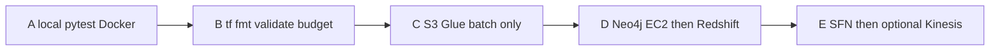

# Scaffold audit, then gated phases

**Status:** inventory and static review only. **Do not claim Glue, Neo4j, Redshift, or Terraform works.** There is no `tests/` tree, no docker-compose, no `terraform validate` log, and the Neo4j Spark jar is not in the repo.

No AWS apply/destroy/push in any phase until you explicitly approve that phase after the previous one shows passing tests.

## 1. What exists vs untested

**Present**

- Glue Spark batch: [glue/jobs/batch_ingest.py](glue/jobs/batch_ingest.py)
- Glue streaming: [glue/jobs/stream_ingest.py](glue/jobs/stream_ingest.py)
- Glue Python shell unload: [glue/jobs/run_cypher_and_unload.py](glue/jobs/run_cypher_and_unload.py)
- Cypher schema (unused by Terraform): [cypher/schema.cypher](cypher/schema.cypher)
- Cypher rules: [cypher/fraud_rules.cypher](cypher/fraud_rules.cypher)
- Terraform monolith: [infra/terraform/main.tf](infra/terraform/main.tf) (VPC, NAT, S3, Kinesis, Firehose, Secrets Manager, Neo4j EC2, three Glue jobs, provisioned Redshift, Step Functions)
- Replay: [scripts/replay_paysim_to_kinesis.py](scripts/replay_paysim_to_kinesis.py)
- Sample CSV: [data/sample/paysim_sample.csv](data/sample/paysim_sample.csv)
- Redshift DDL / COPY notes: [redshift/ddl.sql](redshift/ddl.sql), [scripts/redshift_copy.sql](scripts/redshift_copy.sql)

**Untested / missing**

- Unit tests for transforms, Cypher idempotency, label leakage
- Local Neo4j Docker Compose used by tests
- `terraform fmt` / `terraform validate` (not run)
- Jar upload (`neo4j-connector-apache-spark_2.12-5.3.1_for_spark_3.jar` referenced, not vendored)
- EventBridge; Redshift COPY is not in the state machine
- [cypher/schema.cypher](cypher/schema.cypher) is never applied before the first Spark MERGE

**Immediate code bug (will fail Python shell):** [glue/jobs/run_cypher_and_unload.py](glue/jobs/run_cypher_and_unload.py) uses `sys.argv` at line 13 with **no** `import sys`.

## 2. Findings (file and line)

### Neo4j

- Uniqueness constraints exist in [cypher/schema.cypher](cypher/schema.cypher) lines 1–4, but **batch and stream never run them**. They are created only in [glue/jobs/run_cypher_and_unload.py](glue/jobs/run_cypher_and_unload.py) lines 51–62, **after** Spark MERGE. First concurrent writes can duplicate `Account` / `Transaction` nodes; later `CREATE CONSTRAINT` then fails if duplicates exist.
- MERGE without a guaranteed unique index: [glue/jobs/batch_ingest.py](glue/jobs/batch_ingest.py) 87–101; [glue/jobs/stream_ingest.py](glue/jobs/stream_ingest.py) 101–115. Concurrent batch + stream `MERGE (a:Account {id: …})` is a lock/duplicate race until constraints exist.
- Batch save mode `Overwrite` at [glue/jobs/batch_ingest.py](glue/jobs/batch_ingest.py) line 78 vs stream `Append` at [glue/jobs/stream_ingest.py](glue/jobs/stream_ingest.py) line 92. Connector `Overwrite` can drop target data (or is ignored with `query`; either way it is unsafe next to a live stream). Use `Append`/`ErrorIfExists` + MERGE only, after constraints.
- `txnId` hash omits balances ([batch_ingest.py](glue/jobs/batch_ingest.py) 44–56) so distinct PaySim rows can collide.
- **Community vs GDS:** Terraform user-data pulls `neo4j:5-community` ([infra/terraform/user_data_neo4j.sh.tftpl](infra/terraform/user_data_neo4j.sh.tftpl) lines 8–18) with **no GDS plugin**. Unused [scripts/bootstrap_neo4j.sh](scripts/bootstrap_neo4j.sh) line 23 still sets `gds.`* unrestricted — that does nothing on Community and would mislead a demo. Current Cypher does not call GDS (good). Keep Community; do not document GDS until Enterprise/plugin is explicit.

### Label leakage

- **Rules use ground truth to set the prediction:** [cypher/fraud_rules.cypher](cypher/fraud_rules.cypher) line 35 `WHERE … OR t.isFraud = 1 …` then line 36 `SET t.predictedFraud = true`. Labeled fraud with **no** rule hit is still marked predicted. That is leakage.
- Labels are written onto graph nodes used by scoring: [batch_ingest.py](glue/jobs/batch_ingest.py) 97–98; [stream_ingest.py](glue/jobs/stream_ingest.py) 111–112. Stream’s drain rule (117–122) does not use labels (OK).
- Returning `is_fraud` / `is_flagged_fraud` for evaluation ([fraud_rules.cypher](cypher/fraud_rules.cypher) 47–48; Redshift columns) is fine **if** `predicted_fraud` is independent. Today it is not. Keep labels off the rule graph (or on a separate `:Eval` node / side table) and never `SET predictedFraud` from `isFraud`.

### Cost

- Provisioned Redshift always: [infra/terraform/variables.tf](infra/terraform/variables.tf) 37–44 default `ra3.xlplus` / 1 node; [main.tf](infra/terraform/main.tf) 564–582 no `count`.
- Glue streaming job always defined, timeout 2880 min ([main.tf](infra/terraform/main.tf) 507–515). Terraform does not start it, but README tells you to run it always-on ([README.md](README.md) 56). Kinesis + Firehose ([main.tf](infra/terraform/main.tf) 143–167) still bill when unused.
- Neo4j EC2 default `r6i.large` ([variables.tf](infra/terraform/variables.tf) 21–24; [main.tf](infra/terraform/main.tf) 281–304) plus NAT ([main.tf](infra/terraform/main.tf) 58–65) on every apply.
- No budget alarm; destroy is one README sentence ([README.md](README.md) 35).

**Proposed flags (Phase B, defaults off):** `enable_redshift = false`, `redshift_deployment = "serverless"`, `enable_streaming = false` (skip Kinesis, Firehose, Glue stream job), `enable_neo4j_ec2 = false` until Phase D, `enable_step_functions = false` until Phase E. Smaller default instance e.g. `t3.large` when Neo4j is on.

### Security

- Neo4j **7687** is Glue SG only ([main.tf](infra/terraform/main.tf) 186–192); **7474** is VPC CIDR not `0.0.0.0/0` (194–200). **Pass.** Egress `0.0.0.0/0` on 210–215 is instance outbound, not a listener.
- Redshift `publicly_accessible = false` ([main.tf](infra/terraform/main.tf) 579). **Pass.** Ingress is VPC CIDR (243–248), still broader than Glue/gateway SG.
- S3 public access block **present** (100–106). **Missing** explicit `aws_s3_bucket_server_side_encryption_configuration` and `aws_s3_bucket_versioning`. `force_destroy = true` (97) is easy data loss.
- **Secrets not only in Secrets Manager.** Secret resource exists (169–179) but Glue `--NEO4J_PASSWORD` is in job default_arguments: [main.tf](infra/terraform/main.tf) 478, 530, 552 (console + state). Password also in EC2 user-data (288–290 and tftpl line 14). [terraform.tfvars.example](infra/terraform/terraform.tfvars.example) 6–7 commits example passwords. No Redshift secret. Jobs never `GetSecretValue` at runtime despite IAM (343–345).
- IAM: `AWSGlueServiceRole` (318–321) plus `ec2:*NetworkInterface*` on `Resource = ["*"]` (348–351); Step Functions Glue APIs on `"*"` (431–435). Not least privilege.
- `.gitignore` already ignores `.tfstate`, `.env`, `terraform.tfvars` — keep that; never commit real tfvars.

### Glue / Neo4j connector jar

- Glue 4.0 = Spark **3.3.0**, Scala **2.12** ([main.tf](infra/terraform/main.tf) 460).
- Referenced jar `…_2.12-5.3.1_for_spark_3.jar` (482, 532). Neo4j docs: connector **5.3.x targets Spark 3.4/3.5**; Spark **3.3** maps to **5.1.0** (or EOL table **5.2.0**). **5.3.1 is the wrong Spark line for Glue 4.**
- Jar is not uploaded by Terraform; jobs would fail ClassNotFound even with the right version.
- Extra: `--datalake-formats iceberg` on batch (479) is unused; Python shell is Glue **3.0** (539) vs ETL 4.0.

## 3. Phases (stop after each; tests must pass)

**A — Local only.** Extract a tiny `transforms.py` (cast, `txnId`, drop labels from the rule graph). Docker Compose Neo4j Community; apply schema **before** MERGE. Cypher `WHERE` only on structural rules; `isFraud` only in an eval assertion. Tests: transform unit tests; load sample twice → same node counts (idempotency); labeled fraud without rule hits is **not** `predictedFraud`. No AWS.

**B — Terraform fmt + validate only.** Feature flags defaulting streaming and Redshift **off**. `aws_budgets_budget` + documented destroy in README. `terraform fmt` and `terraform validate` (no apply). Strip passwords from job args/user-data/example tfvars; document `TF_VAR_`*. Pin jar Maven coord `org.neo4j:neo4j-connector-apache-spark_2.12:5.1.0_for_spark_3`.

**C — Batch deploy.** `count` S3 + Glue batch job only. Constraints-first bootstrap. Still no claim until a Glue run on sample CSV is observed (this phase’s test).

**D — Neo4j EC2, then Redshift.** EC2 Community + SSM; constraints in user-data **before** Bolt opens. Redshift via `redshift_deployment = serverless` when `enable_redshift`. COPY + `fraud.v_latest_flags` with labels as eval columns only.

**E — Step Functions / EventBridge, then Kinesis.** Streaming resources `count` on `enable_streaming` default false. Stream job `Append` + MERGE; no `Overwrite`.

## Design decisions to defend

- **Constraints before MERGE:** uniqueness is a correctness requirement under concurrent writers, not an optimization.
- **Labels off the rule path:** otherwise precision/recall is circular (the model “detects” the PaySim label).
- **Cost flags default off:** ra3.xlplus + NAT + Kinesis/Firehose + Glue streaming dominate a student/demo bill.
- **Secrets Manager at runtime:** Glue default_arguments and EC2 user-data are visible; Terraform sensitive vars still land in state — retrieve at run, do not pass as job params.
- **Connector 5.1.0 _2.12 for Spark 3:** matches Glue 4; 5.3.1 does not.

## After approval

Start **Phase A only**. After that phase: list changed files + test output, then stop.